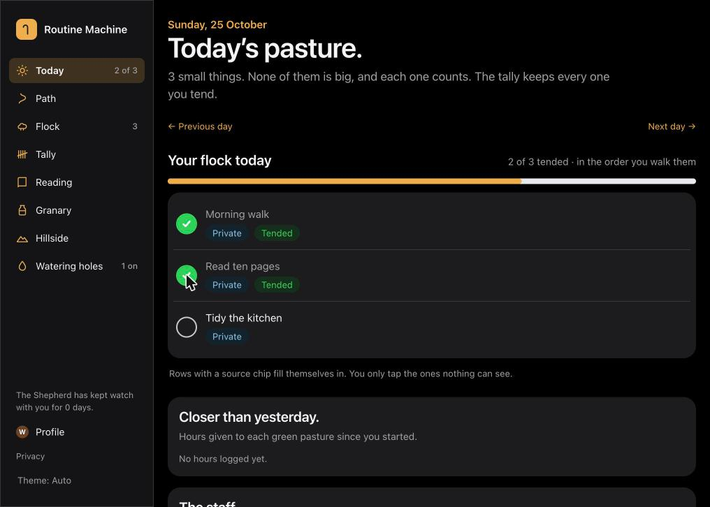
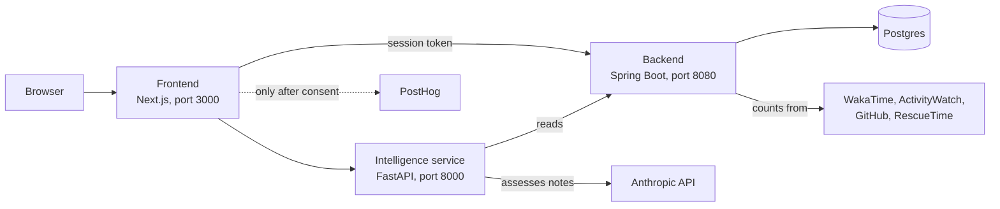

# Routine Machine

A daily-routine tracker for people who stall when a plan looks too big: it leads with a little a day, counts it honestly, never punishes a missed day, and learns from your own records before it suggests anything.



*Today, from a test account with three routines. A brand-new account sees a "your first step" card instead ([screenshot](docs/screenshots/today-first-step.jpg)).*

## What works today, what is in progress, what is planned

**Works** (built, tested, in the status log in `PROJECT.md`):

- Daily logging of routines and learning, with a fixed weekly schedule (Today, Path, Flock, Tally).
- Pattern statistics: completion rates, streaks, skip-heavy days, and a first learning-versus-routines correlation.
- Automatic counting from WakaTime, ActivityWatch, GitHub and, optionally, RescueTime, plus a health-data ingest endpoint.
- Reader's notes assessed by a language model, with a stated threshold for "your own words".
- The hillside: an opt-in, anonymous, k-anonymous board by days shown up, and a credit ledger fed by evidence.
- Profile and analogies, the granary (small savings and "the pause" before a spending decision, M-Pesa statement import), organisations and cohorts with a pilot dashboard.
- Accounts with password login, and every personal route acts only for the signed-in person.
- An owner-only operations page (metrics, logs, traces, alerts) and owner-only API documentation for both services.
- Opt-in product analytics (PostHog), consent first.

**In progress:** the repository standard and first-run flow (this README, CI, the new-user walk-through). See `PROJECT.md`, Backlog.

**Planned, not built:** active reprioritisation (Phase 4, which waits on real logged data, not a date); GitHub and Google sign-in; hosting, file storage and deployment automation.

## Run it

You need Docker. Everything else runs in containers.

```bash
git clone https://github.com/Miguel-Shinyenyi/routine-machine.git
cd routine-machine
cp infra/.env.example infra/.env
# Open infra/.env and set AUTH_JWT_SECRET to a random string of 32 or more characters:
#   openssl rand -base64 48
docker compose -f infra/docker-compose.yml up --build
```

If port 5432 is already taken on your machine, set `POSTGRES_HOST_PORT=5433` (or any free port) in `infra/.env` before the last command. The services reach Postgres inside Docker and are not affected.

Then open <http://localhost:3000>, choose "Create account", and follow the first-step card.

| Service | Port | Folder |
|---|---|---|
| Frontend (Next.js) | 3000 | `frontend/` |
| Backend (Spring Boot) | 8080 | `backend/` |
| Intelligence service (FastAPI) | 8000 | `intelligence-service/` |
| Postgres | 5432 | `infra/` |

**Environment variables** (names only; the file `infra/.env.example` explains each one and `infra/.env` is git-ignored): `AUTH_JWT_SECRET` (required), `AUTH_INTERNAL_TOKEN`, `OWNER_EMAIL`, `HEALTH_INGEST_TOKEN`, `ANTHROPIC_API_KEY`, `ANTHROPIC_INPUT_USD_PER_MTOK`, `ANTHROPIC_OUTPUT_USD_PER_MTOK`, `WAKATIME_API_KEY`, `ACTIVITYWATCH_BASE_URL`, `RESCUETIME_API_KEY`, `RESCUETIME_SYNC_ENABLED`, `GITHUB_TOKEN`, `UMWAYI_JOURNAL_KEY_B64`, `GRAFANA_ADMIN_PASSWORD`, `POSTGRES_HOST_PORT`, `POSTHOG_KEY`, `POSTHOG_HOST`, `PRIVACY_CONTACT`. The compose file insists on `AUTH_JWT_SECRET` only. Each integration is meant to stay off until its own variable is set.

**Migrations** run by themselves: the backend applies its Flyway migrations (`backend/src/main/resources/db/migration/`) when it starts.

**Tests**

```bash
cd backend && ./mvnw test                  # needs Docker, for Testcontainers
cd intelligence-service && pip install -r requirements-dev.txt && pytest
cd frontend && npm ci && npm run lint && npm test && npm run build
```

At the last full run: 481 backend tests, 87 intelligence-service tests and 203 frontend tests passed. CI runs the same three on every pull request (`.github/workflows/ci.yml`).

## How it fits together



Key decisions (each is recorded with its reasons in the docs):

- **Polyglot, one repository.** Spring Boot owns the data and the rules; a small Python service does the statistics, suggestions and the model calls. The folders keep their names on purpose (`PROJECT.md`, "Repo structure decision").
- **Sequence before intelligence.** Build the data layer correctly, add pattern detection once there is data, and gate active reprioritisation on real logged data. A fixed, non-adaptive schedule is the useful middle step.
- **Nothing punishes a missed day.** No streak counters that reset; "wandered" days carry no penalty.
- **The person comes from the signed token.** No route trusts a user id sent in the request body or query (`docs/backend.md`, access control).
- **Private stays private.** Routines marked private are counted for you and never leave your tally; money never reaches the hillside.
- **Documentation is part of the change.** Every component has a doc under `docs/`, updated in the same change as its code (`docs/DOCS_MAINTENANCE.md`).

Start with `PROJECT.md`, then the doc for the part you are touching. `CLAUDE.md` has the routing table.

## Privacy

Analytics are **off unless the operator configures them**, and even then nothing is counted until a visitor accepts. Declining means not counted at all; Do Not Track and Global Privacy Control are honoured. We never send an email, a name, anything you write, an amount of money or a note's text. People are identified by an internal number only, and session replay is off everywhere. The public `/privacy` page lists every event and what it carries, built from the same list a test holds equal to the code. It is written with Kenya's Data Protection Act, 2019 in mind and has not had a legal review. Details: `docs/frontend.md`, "Analytics".

## Contributing and security

- Read `CONTRIBUTING.md`. Write the failing test first, update the doc in the same change, and keep secrets out of every file.
- **To report a security problem, do not open an issue.** Follow `SECURITY.md`.
- Released under the MIT license (`LICENSE`).

## Why it exists

Directly from the person building it: "sometimes I feel like it's a lot so I end up doing nothing." This system counters that by leading with a little a day, tracked honestly, rather than a plan that looks complete on paper and never gets touched.

It is also portfolio evidence of AI engineering, not only backend engineering, and it serves three personal goals: a CMU masters application (Fall 2027 cycle), target roles including PostHog, and becoming a working AI engineer rather than claiming the title. Journaling and writing in the UMWAYI context hub feed it (`docs/hub-sync.md`).
